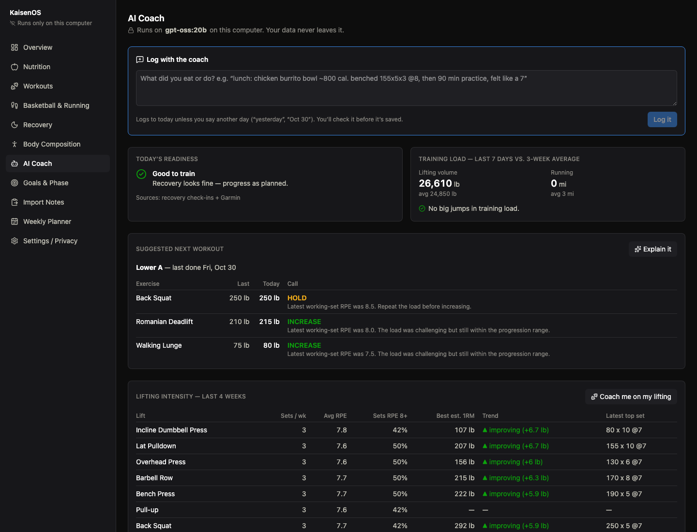
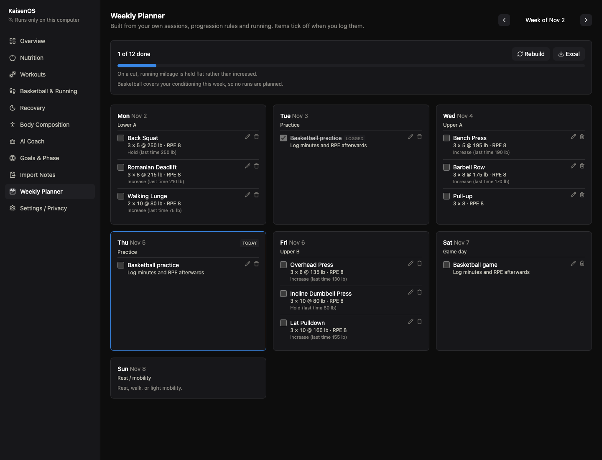
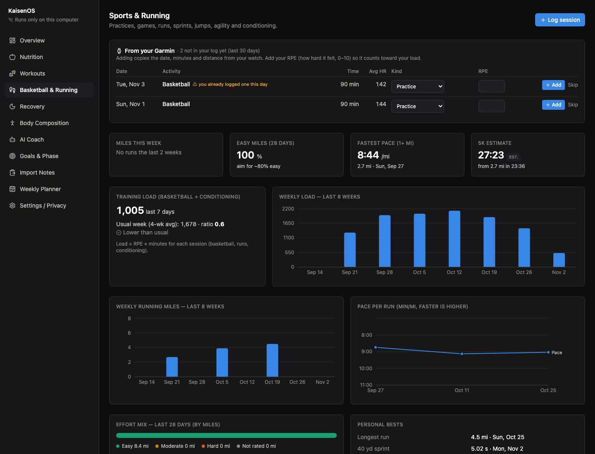
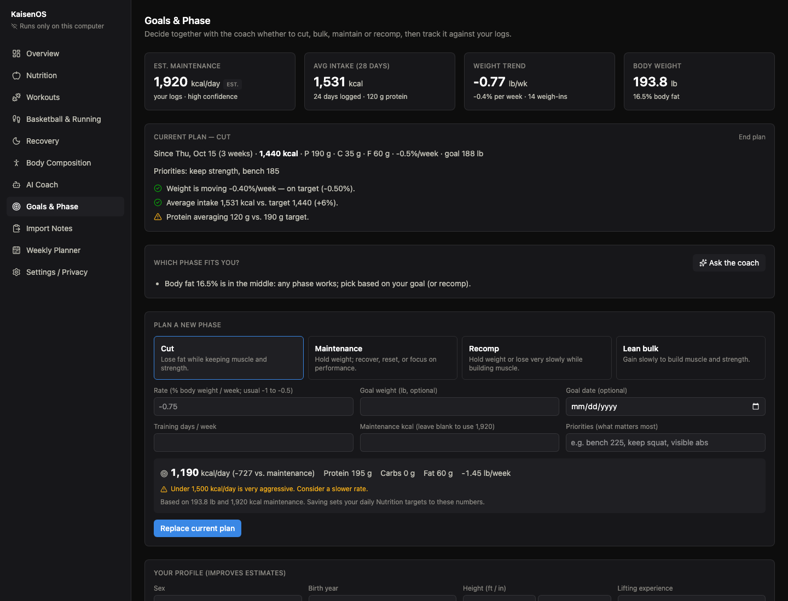
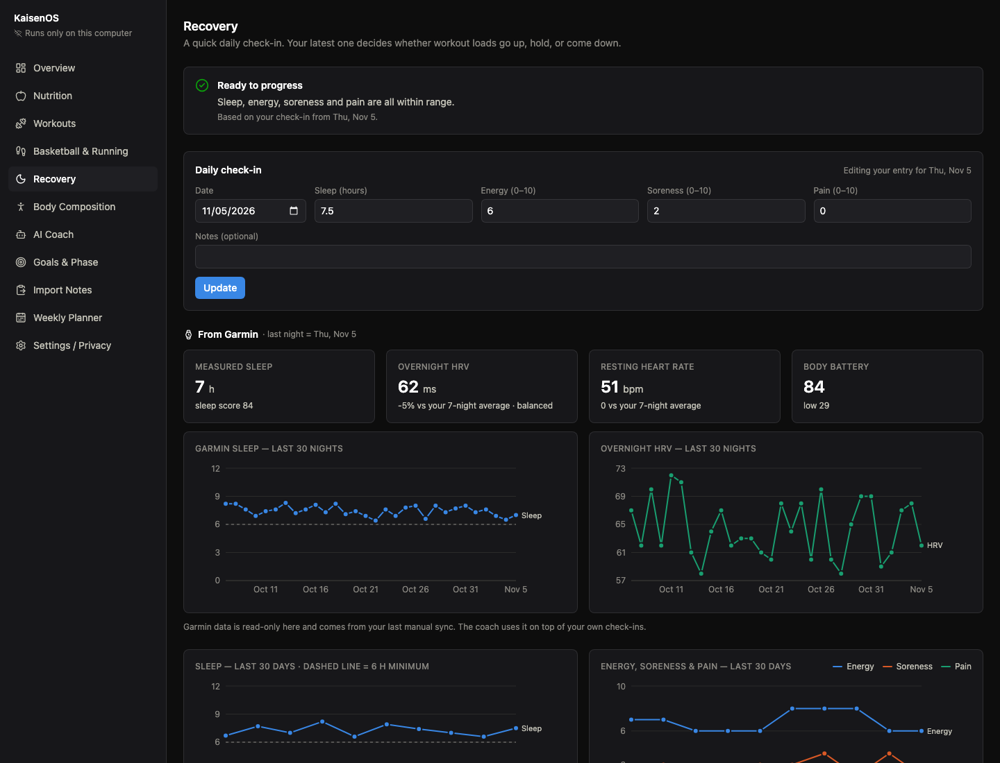
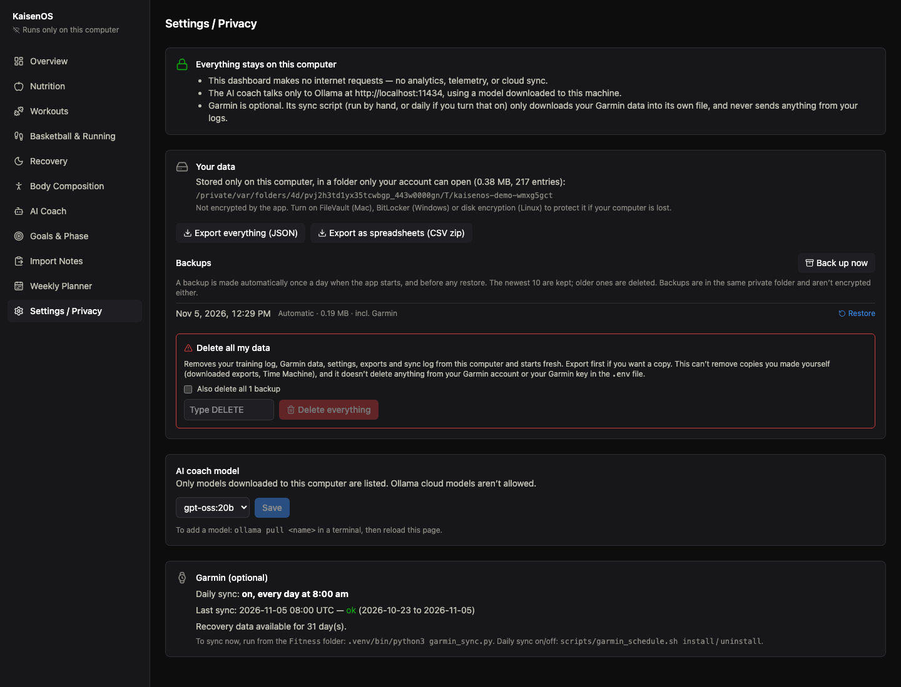
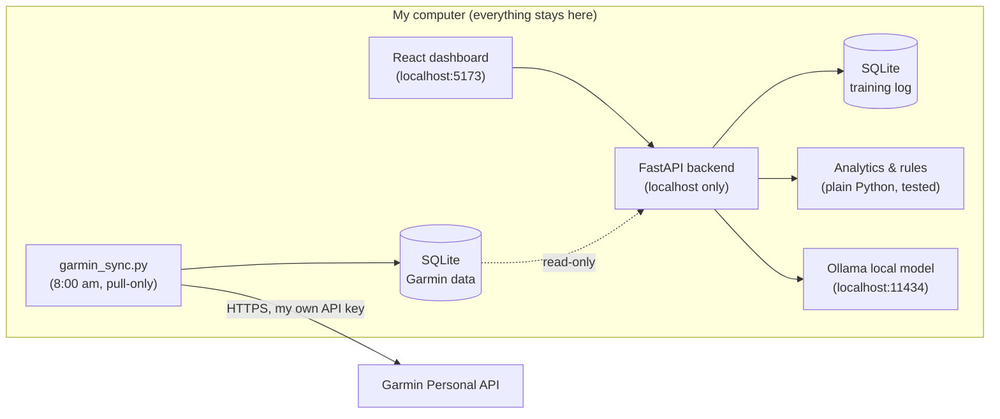

# KaisenOS — My Private AI Training Coach

**A full-stack fitness and performance dashboard I built for myself and use every day.** It tracks my lifting, nutrition, basketball, running, recovery and body composition, and it includes an AI coach that runs **entirely on my own computer**. My health data never goes to the cloud.

I play basketball and lift, and I wanted one place that understands both, without handing my sleep, heart-rate and diet data to another app's servers. So I built it.



**[Try it](#install-and-run)** · **[Privacy](PRIVACY.md)** · **[Security](SECURITY.md)** · MIT licensed

---

## Why I built it

Most fitness apps do one thing (calories *or* lifting *or* running), live in the cloud, and give generic advice. I wanted:

- **One system for everything I do**: lifting, basketball, running, food, sleep and recovery, so the advice accounts for all of it. A heavy leg day before a game is a problem whatever app it's logged in.
- **Privacy by design**: my health data stays on my machine. The AI model runs locally through [Ollama](https://ollama.com), and the dashboard makes no internet requests at all.
- **Advice I can trust**: the AI explains and talks, but every number (calories, loads, readiness, training load) is computed by plain, tested code from my real logs. It isn't guessed by a language model.
- **Logging that's fast enough to keep doing**: I can type *"lunch: chicken burrito bowl ~800 cal, benched 165x5x3 @8, 90 min practice, felt like a 7"* and it lands in the right places.

---

## How I use it every day

| When | What happens |
|---|---|
| **8:00 am** | My Mac automatically pulls last night's **sleep, HRV, resting heart rate and body battery** from my Garmin watch. |
| **Morning** | I open the **AI Coach**. It gives me a readiness call (**Good to train / Hold loads / Back off**) based on my check-in and my watch data, plus today's planned workout with exact weights. |
| **Meals** | I tell the coach what I ate in plain English. It shows me what it understood, I fix anything that's off, and it saves to my nutrition log, with protein and calories left for the day. |
| **Lifting** | The **Weekly Planner** tells me which session is next and what to load, based on how my last sessions went (RPE-based progression). Sets tick off as I log them. |
| **Basketball** | Practices and games come in from my watch with one click. I add how hard it felt (RPE), and the app tracks my training load and flags spikes that raise injury risk. |
| **Weekly** | I check **Goals & Phase** to see whether I'm cutting, bulking or maintaining at the right rate, and ask the coach what to adjust. |

---

## Features

### AI coach (local LLM)
- **Readiness call** from my own check-ins plus Garmin data (sleep, HRV against my 7-day baseline, resting heart rate).
- **Suggested next workout** with exact loads, held or lightened automatically when recovery is poor.
- **Log by talking**: plain-language entries become structured logs, with a review step before anything saves.
- **Lifting analysis**: sets per week per muscle group, average RPE, estimated 1-rep-max trends, and the 3 most useful changes to make.
- **Safety-first prompt**: general training guidance only, never trains through pain, and points to a doctor or physical therapist when pain is logged.

### Weekly Planner
- Builds my week from **the sessions I actually do**, with my exercises, sets and reps, and loads from the progression rules.
- Works around my **schedule**: I mark days as open, busy, practice or game. Heavy leg work stays off the day before games, and basketball days replace runs.
- Running follows sensible rules: mileage up at most 10% a week, about 80% easy, long run on the weekend.
- Items auto-complete when I log them. Exports to Excel.



### Basketball & Running
- Log practices, games, runs, sprints, jumps and conditioning.
- **Session load** (RPE × minutes) with an **acute:chronic ratio**. Over 1.5× my usual week gets flagged as a spike.
- Weekly mileage, pace trend, easy/hard effort split, personal bests and a 5K estimate.
- **One-click import from Garmin**: watch activities show up ready to add, with duplicate detection.



### Nutrition
- Meals by day with eaten-vs-target bars for calories, protein, carbs and fat.
- Saved foods for quick re-logging. Estimated values are always labeled as estimates.

### Goals & Phase (cut / bulk / maintain / recomp)
- Estimates my **maintenance calories from my own data**: logged intake plus my weight trend (≈3,500 kcal per lb), with a confidence level.
- Plans a phase at evidence-based rates (cut 0.5–1% body weight per week, lean bulk 0.25–0.5%) and sets my daily targets.
- Progress checks: am I losing or gaining at the planned rate, hitting protein, keeping strength on a cut?



### Recovery & Body Composition
- Daily check-ins (sleep, energy, soreness, pain) and Garmin's measured sleep, HRV, resting heart rate and body battery.
- Body-weight trend using a 7-day average, since single weigh-ins are noisy.



### Your data, your control
- Everything is stored in one private folder on your computer, outside the code. Export it all as JSON or spreadsheets, back up and restore with one click, or delete everything.



### Import Notes
- I had a month of training and meal notes in my phone. I pasted them in, and it split them by day, read each day, and showed everything for review. It also listed any line it couldn't understand, so nothing was silently lost.
- Every import can be undone in one click.

---

## How it works



**Key design decisions** (the parts I'd talk about in an interview):

1. **The model interprets; code decides.** The language model turns messy text into structured data and writes the explanations. Readiness, progression, calorie targets, training load and the weekly plan are deterministic Python, so they're consistent and testable.
2. **Confirm before write.** Anything the AI extracts goes through a review screen. Nothing touches the database until I approve it, and every import is a single undoable batch.
3. **Nothing silently dropped.** In early testing the model skipped a meal from my notes. So each extracted item keeps the text it came from, and any line that doesn't match is shown back to me.
4. **One network path, enforced by tests.** Only the Garmin sync script may use the internet. It's pull-only and keeps Garmin data in a separate file. A test fails the build if network code shows up anywhere else.
5. **The local model is locked down.** The Ollama client refuses non-localhost addresses, ignores proxy and environment overrides, won't follow redirects, and won't use Ollama "cloud" models.
6. **Built for other people's data too.**
   - Data lives outside the code in an owner-only folder.
   - The local server rejects requests from other websites (DNS-rebinding and CSRF protection) and has a strict content security policy.
   - Export, backup, restore and delete are all built in.
   - A scanner keeps personal data and secrets out of the repo. See [SECURITY.md](SECURITY.md).
7. **Safe database changes.** Schema migrations only ever add, so existing data is never dropped. The database is backed up before every schema change.

---

## Tech stack

| Layer | Tools |
|---|---|
| Frontend | React, TypeScript, Vite, Tailwind CSS, Recharts |
| Backend | Python, FastAPI, Pydantic |
| Data | SQLite (training log + separate Garmin store) |
| AI | Ollama running `gpt-oss:20b` locally, with structured JSON output |
| Integrations | Garmin Personal API (scheduled with a macOS LaunchAgent) |
| Testing | pytest (134 tests on generated fake data, including security and privacy tests); GitHub Actions CI with CodeQL, pip-audit, npm audit and a repo safety scan |

---

## What this project shows

- **Full-stack product work**: 11 pages, a REST API, a database and data visualization, all designed around how I actually train.
- **Applied AI with guardrails**: using an LLM where it's strong (understanding messy language) and keeping it out of decisions that need to be exact.
- **Privacy and security engineering**: local-first architecture, secrets kept out of code and git, tests that enforce the network boundary, and locked-down model access.
- **Domain modeling**: training load, progressive overload, energy balance and periodization (cut/bulk), turned into clear, tested rules.
- **Shipping and iterating**: built incrementally from my own daily use, fixing real problems as I found them (dropped meals, duplicate check-ins, outdated recovery data).

> **How it was built:** I designed and directed this project and used an AI pair-programmer (Claude Code) to write much of the code. I made the product, privacy and architecture decisions, reviewed the changes, and tested everything against my own daily use.

---

## Install and run

KaisenOS runs on **your** computer, with **your** data. Nothing is shared with me or anyone else.

**You need:**
- macOS or Linux (Windows: see below)
- [Python 3.12+](https://www.python.org/downloads/) and [Node.js 20+](https://nodejs.org)
- [Ollama](https://ollama.com) for the AI coach (optional; everything else works without it)

```bash
git clone https://github.com/<you>/KaisenOS.git
cd KaisenOS
./setup.sh           # installs into this folder only; suggests an AI model that fits your computer
./start.sh --demo    # try it with made-up data first (nothing saved)
./start.sh           # start for real: opens http://127.0.0.1:8000
```

**Where your data goes:**
- It's kept in a private folder outside the app (macOS: `~/Library/Application Support/KaisenOS`).
- You can export it, back it up or delete it anytime from **Settings**.
- Read [PRIVACY.md](PRIVACY.md) for every detail.

**Garmin (optional):**
1. `cp .env.example .env`
2. Add your [Personal API key](https://connect.garmin.com/app/settings/personalApiToken), then `chmod 600 .env`
3. Run `Fitness/.venv/bin/python3 Fitness/garmin_sync.py`

On macOS you can turn on a daily 8 am sync with `Fitness/scripts/garmin_schedule.sh install`.

**Windows** isn't covered by the scripts yet. You can run it manually:
```powershell
cd Fitness
python -m venv .venv
.venv\Scripts\pip install -r requirements.txt
cd frontend
npm ci
npm run build
cd ..
.venv\Scripts\python run.py
```

**Updating:** `git pull && ./setup.sh`. Your data isn't touched; database changes only ever add, and a backup is made automatically.

> **Not medical advice.** KaisenOS gives general fitness information and does not diagnose or treat anything. For pain, injury or health concerns, see a doctor or physical therapist.

---

*Screenshots show the built-in demo mode (`./start.sh --demo`): made-up data, not my personal records.*
